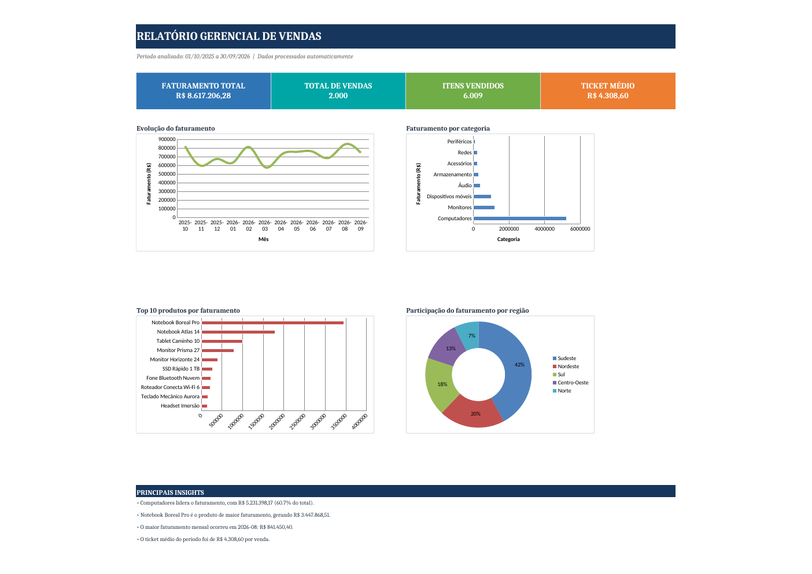

# Automated Sales Report

Projeto de portfólio para automatizar a geração de um relatório gerencial de vendas a partir de dados sintéticos.

## Objetivo

Demonstrar um fluxo de dados completo em Python, saindo de dados brutos até um relatório executivo em Excel:

```text
Dados brutos → validação → transformação → análise → relatório gerencial
```

O projeto foi pensado para simular uma rotina de análise de dados em que a execução do pipeline atualiza o dataset, processa os registros e entrega um relatório pronto para análise.

## O que o projeto entrega

- geração de 2.000 vendas sintéticas;
- validações de qualidade e consistência dos dados;
- transformação das datas para análise temporal;
- cálculo automático de KPIs;
- análises por categoria, produto, vendedor, região e pagamento;
- evolução mensal do faturamento;
- dashboard executivo em Excel;
- gráficos e rankings para apoio à análise;
- geração automática de insights principais;
- testes automatizados das regras críticas do pipeline.

## Dashboard



O relatório Excel apresenta uma visão executiva com:

- **Faturamento total**;
- **Total de vendas**;
- **Itens vendidos**;
- **Ticket médio**;
- evolução mensal do faturamento;
- faturamento por categoria;
- top 10 produtos por faturamento;
- participação do faturamento por região;
- principais insights gerados automaticamente.

As abas detalhadas permanecem disponíveis para auditoria dos indicadores e exploração dos dados.

**[Baixar o relatório Excel de exemplo](output/relatorio_vendas.xlsx)**

### Resultado da execução

| Indicador | Resultado |
|---|---:|
| Vendas | 2.000 |
| Itens vendidos | 6.009 |
| Faturamento | R$ 8.617.206,28 |
| Ticket médio | R$ 4.308,60 |
| Período | 01/10/2025 a 30/09/2026 |

## Tecnologias

- Python 3
- Pandas
- NumPy
- OpenPyXL
- Pytest
- Git/GitHub

## Estrutura

```text
automated-sales-report/
├── data/
│   ├── raw/
│   └── processed/
├── output/
├── src/
│   ├── generate_data.py
│   ├── load_data.py
│   ├── transform.py
│   ├── report.py
│   └── main.py
├── tests/
│   ├── test_generate_data.py
│   └── test_report.py
├── requirements.txt
└── README.md
```

## Como executar

No PowerShell, dentro da pasta do projeto:

```powershell
python -m venv venv
venv\Scripts\Activate.ps1
pip install -r requirements.txt
python src\main.py
```

Para executar os testes:

```powershell
pytest -q
```

O pipeline irá:

1. gerar `data/raw/vendas.csv`;
2. preparar `data/processed/vendas_processadas.csv`;
3. gerar `output/relatorio_vendas.xlsx`.

### Reprodutibilidade

O gerador utiliza uma seed fixa (`42`) e um período de referência fixo de **outubro de 2025 a setembro de 2026**. Assim, a execução do projeto produz o mesmo dataset e os mesmos indicadores, independentemente do dia em que o pipeline seja executado.

## Qualidade dos dados

Antes da geração do arquivo final, o projeto verifica regras como:

- quantidade esperada de registros;
- IDs únicos e sequenciais;
- ausência de valores nulos nas colunas obrigatórias;
- valores positivos de quantidade e preço;
- consistência entre `quantity × unit_price` e `total_value`.

## Observação

Os dados são fictícios e existem exclusivamente para fins de estudo e portfólio. O projeto não representa dados reais de uma empresa.
